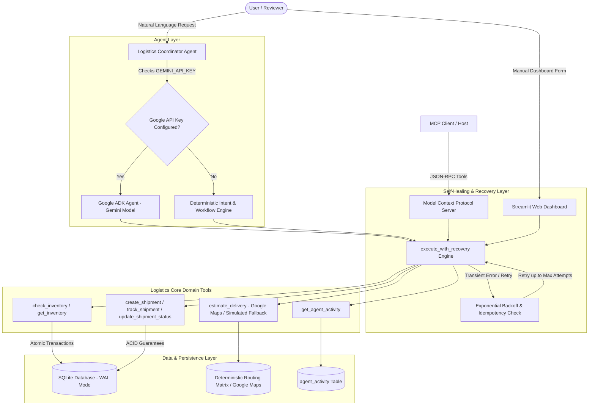
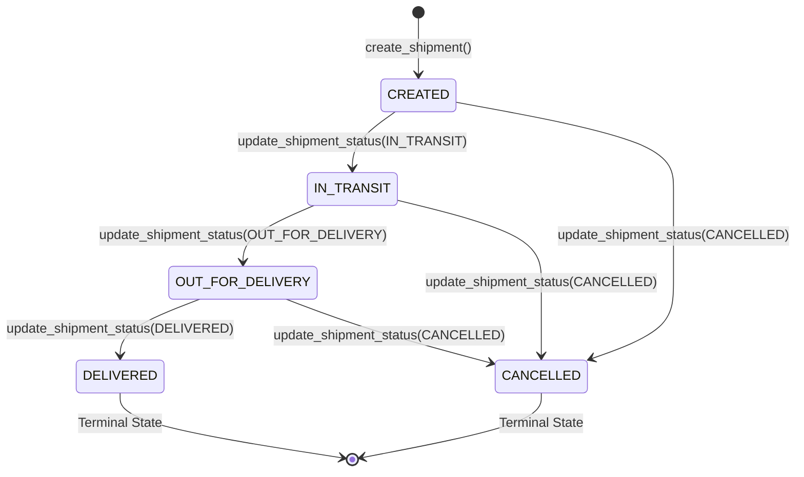
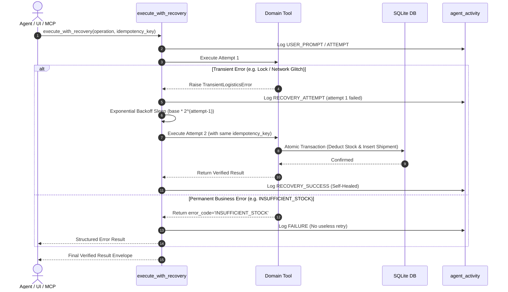

# Logistics Handler AI Agent — Architecture & Technical Specifications

## 1. System Overview

The **Logistics Handler AI Agent** is an enterprise-grade autonomous operations agent designed to handle end-to-end logistics workflows, including natural language instruction interpretation, stock availability validation, shipment creation, multi-modal routing estimation, lifecycle status tracking, and bounded self-healing.

---

## 2. Core Components

### 2.1 Google ADK Logistics Coordinator Agent (`logistics/agent.py`)
- **Primary Framework**: Built on **Google ADK (Agent Development Kit - `google-adk`)** and powered by **Google Gemini** (`gemini-2.5-flash` / `gemini-1.5-flash`).
- **Dual Operating Modes**:
  1. **Google ADK Mode**: Connects via `google.adk.Agent` and `google.adk.Runner` with Gemini models. Automatically binds type-annotated domain tools (`GOOGLE_ADK_TOOLS`), interprets natural language instructions, executes multi-step workflows, and synthesizes operational summaries.
  2. **Demo Mode**: Active when `GEMINI_API_KEY` / `GOOGLE_API_KEY` is unconfigured or when Demo Mode is explicitly selected. Leverages a local deterministic intent parser and entity extractor that executes the exact same underlying tools and workflows.
- **Strict Grounding Guarantees**:
  - Never invents shipment IDs or stock numbers.
  - Never claims a shipment was created unless verified in the SQLite database.
  - Automatically identifies missing parameters (e.g. quantity, origin, destination) and requests clarification.

### 2.2 Domain Tools
- **`check_inventory(product, quantity)`**: Validates positive integer quantity, normalizes singular/plural product names, checks real-time available stock.
- **`create_shipment(origin, destination, product, quantity, idempotency_key)`**:
  - Validates input (ensures origin != destination, quantity > 0).
  - Verifies stock availability.
  - Executes atomic inventory deduction and shipment record creation in a single SQLite transaction.
  - Verifies database state post-commit.
- **`track_shipment(shipment_id)`**: Retrieves shipment status, route, and timeline. Returns structured error if shipment ID does not exist.
- **`estimate_delivery(origin, destination)`**: Computes route distance and estimated delivery dates. Clearly flags simulated routing when live GPS/routing APIs are unconfigured.
- **`update_shipment_status(shipment_id, new_status)`**: Enforces strict state machine transitions and logs updates.
- **`get_agent_activity(limit)`**: Retrieves structured audit trail of agent actions, tool calls, and recovery events.

---

## 3. Shipment Lifecycle State Machine

Invalid transitions (e.g., `DELIVERED -> CREATED` or `CANCELLED -> IN_TRANSIT`) are strictly rejected with error code `INVALID_STATUS_TRANSITION`.

---

## 4. Feedback Loop & Self-Healing Architecture

Every operation passes through a 7-stage feedback loop:

### Self-Healing Features:
1. **Bounded Retries**: Maximum attempts capped (default: 3).
2. **Safe Backoff**: Exponential sleep prevents stampeding.
3. **Idempotency Protection**: A unique key is propagated; retrying a creation never duplicates a shipment or double-deducts inventory.
4. **Permanent Business Error Fast-Path**: Non-transient errors (`INSUFFICIENT_STOCK`, `UNKNOWN_PRODUCT`, `INVALID_QUANTITY`, `INVALID_STATUS_TRANSITION`) are rejected immediately without wasting retry budgets.
5. **Simulated Failure Mode**: Allows reviewers to simulate $N$ transient failures via a single toggle or UI button to observe recovery in real-time.

---

## 5. Model Context Protocol (MCP) Integration

The MCP server (`mcp_server/server.py`) exposes all 6 core domain tools over standard I/O (stdio) using the official Model Context Protocol Python SDK (`mcp>=1.0.0`):

- `check_inventory`
- `create_shipment`
- `track_shipment`
- `estimate_delivery`
- `get_inventory`
- `get_agent_activity`

The MCP layer is cleanly decoupled from business logic and runs independently of the Streamlit UI or OpenAI Agent orchestrator.
